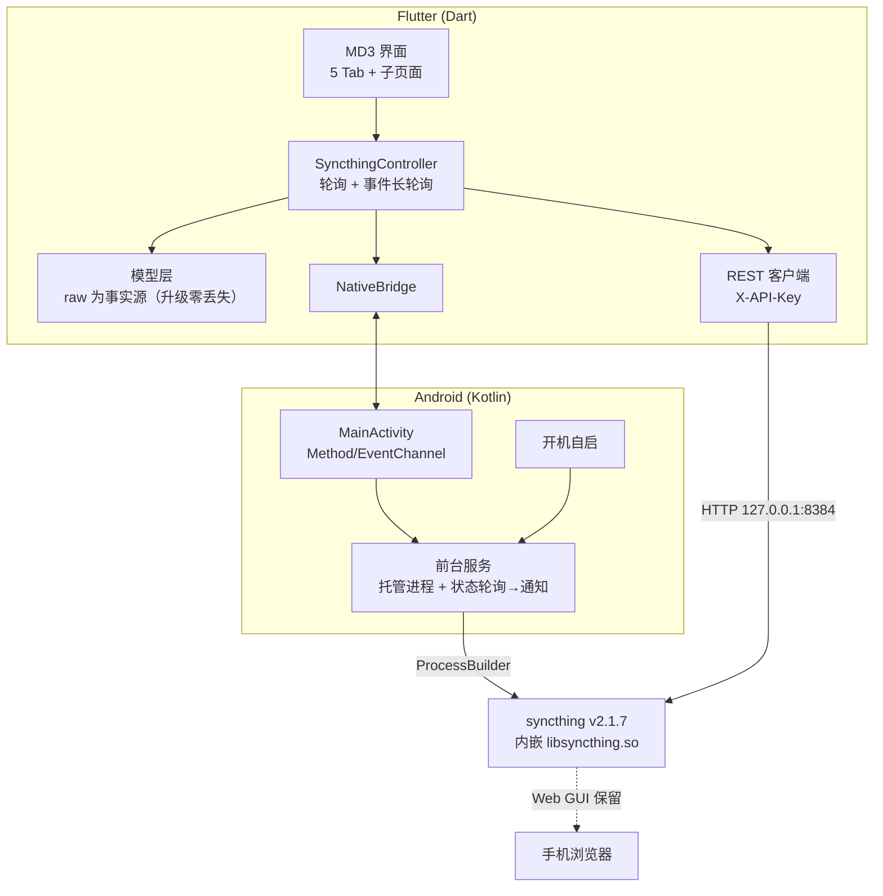

<div align="center">

>[!WARNING]
> # AI泔水
> 项目：[pikaqiang-up/syncthing_shell](https://github.com/pikaqiang-up/syncthing_shell)

# Syncthing for Android

**Syncthing 的原生 Android 壳** — 内嵌二进制 · REST 驱动 · Material 3

[](#编译)
[](https://syncthing.net)
[](https://flutter.dev)
[](https://m3.material.io)

完全脱离 Syncthing 自带 Web 前端的原生 MD3 界面（Web 前端仍保留，可在浏览器打开）。

</div>

---

## 截图

| 状态总览 | 文件夹 | 文件夹详情 |
|:---:|:---:|:---:|
|  |  |  |

| 设备 ID 二维码 | 日志（MD3 卡片流） | 设置 |
|:---:|:---:|:---:|
|  |  |  |

浅色模式（可切换 跟随系统 / 浅色 / 深色）：

| 浅色·状态总览 | 浅色·文件夹编辑 |
|:---:|:---:|
|  |  |

通知栏实时显示同步状态（速率、逐文件夹进度）：


## 功能

- **完全覆盖 Syncthing Web 前端功能** — 文件夹（6 种版本控制 / 忽略模式含规则测试 / 文件浏览 / 版本恢复 / 仅发送覆盖 / 仅接收回退）、设备（扫码添加 / ID 校验 / 介绍人 / 速率限制）、待定设备与共享邀请、全局与本机统计、最近更改
- **Material 3** — 动态取色（Android 12+ 壁纸色），明暗模式默认跟随系统
- **前台服务 + 智能通知** — 常驻通知实时显示速率与逐文件夹同步进度，独立于 UI 运行
- **内嵌二进制** — Syncthing v2.1.7 打包进 APK（Termux 官方包构建，16K 页对齐），无需 root、开箱即用
- **升级友好** — 一键脚本完成 升级二进制 → 校验 → API 快照对比
- 中文界面

## 编译

> **本仓库不含 Syncthing 二进制**（约 35MB，不入库）。
> 克隆后必须先运行第一步脚本获取二进制，否则 `flutter build` 会失败
> （错误信息为「找不到内嵌的 syncthing 二进制」或 Gradle 报 jniLibs 缺失）。

```bash
# 0) 依赖：Flutter 3.44+、Android SDK（API 36）、JDK 17+、curl/unzip
#    国内网络建议先设置：
export PUB_HOSTED_URL=https://pub.flutter-io.cn
export FLUTTER_STORAGE_BASE_URL=https://storage.flutter-io.cn
#    Gradle 的 google() 仓库若不可达，用 dl.google.com 直链替代
#    （可参考 ~/.gradle/init.d 里把 maven.google.com 重写为
#      https://dl.google.com/dl/android/maven2 的 init 脚本）

# 1) 获取内嵌二进制（从 Termux 官方仓库下载 arm64 包，sha256 校验后装入 jniLibs）
scripts/update_syncthing.sh            # 自动取最新版；或指定：scripts/update_syncthing.sh 2.1.7

# 2) 构建
flutter pub get
flutter test
flutter build apk --release
# 产物 build/app/outputs/flutter-apk/app-release.apk（~46MB，仅 arm64-v8a）
```

### 编译要点

| 事项 | 说明 |
|---|---|
| 二进制来源 | `scripts/update_syncthing.sh` 从 Termux 官方仓库拉取（[原因](#为什么二进制来自-termux-仓库)），校验和与官方索引核对 |
| abiFilters | 默认仅 `arm64-v8a`；模拟器调试可用 `flutter build apk -PtargetAbi=arm64-v8a,x86_64 --release` |
| `useLegacyPackaging=true` | 已配置，勿改——`.so` 必须解压到 `nativeLibraryDir` 才能被 exec |
| Android SDK 位置 | `flutter config --android-sdk <路径>`；或 `local.properties` |
| 升级 Syncthing | 重跑 `scripts/update_syncthing.sh` 即可（装了 Go 工具链会额外生成 API 快照对比，辅助适配） |

## 架构



文件/函数级详细文档：[docs/README_DETAILED.md](docs/README_DETAILED.md)

### 为什么二进制来自 Termux 仓库？

Syncthing v2 已停发 android 官方包；官方 linux 预编译包是 cgo + 静态 glibc，
在 Android 上 `pthread_create` 崩溃。Termux 包以 `GOOS=android` + NDK 构建
（bionic PIE、16K 页对齐、仅依赖系统库），是唯一在真机与模拟器都验证可用的来源。
来源与校验方式见 `scripts/update_syncthing.sh` 与 `third_party/syncthing/BINARY.txt`（构建后生成）。

## 常见问题

<details>
<summary><b>速率一直显示 0 或 —</b></summary>

没有对端连接或没有文件在传输时，速率本来就是 0。确认对端设备在线且存在差异文件；
同步进行中会显示实时速率（客户端按累计字节差分计算，v2 API 已无现成速率字段）。
</details>

<details>
<summary><b>界面一直「等待 API 就绪」</b></summary>

最常见原因：设备上运行着另一个 Syncthing（Termux 直跑或其它壳），抢先占用了
`127.0.0.1:8384`。同一时间只能运行一个 Syncthing 实例。
</details>

<details>
<summary><b>文件夹添加了但一直是空的</b></summary>

未授予「所有文件访问权限」：设置 → 服务 → 所有文件访问权限。
</details>

<details>
<summary><b>和官方 Syncthing Android / Syncthing-Fork 是什么关系？</b></summary>

无关系。官方 App 已于 v2 前停更（停留在 v1 内核）；本项目内嵌 v2.1.7 二进制并以
Flutter 重写完整界面。设备 ID 与配置格式完全兼容，可无缝加入现有同步集群。
</details>

## 隐私

- 不收集、不上传任何数据，不含统计 SDK
- 同步流量按 Syncthing 协议点对点/中继传输，本壳不介入
- 「匿名使用报告」默认未决定，由你在设置中掌控（数据只发给 Syncthing 官方统计）

## 致谢

- [Syncthing](https://syncthing.net)（MPL-2.0）— 同步内核；二进制来自 [Termux](https://termux.dev) 官方仓库构建
- 图标字体：Material Icons（Apache-2.0）
