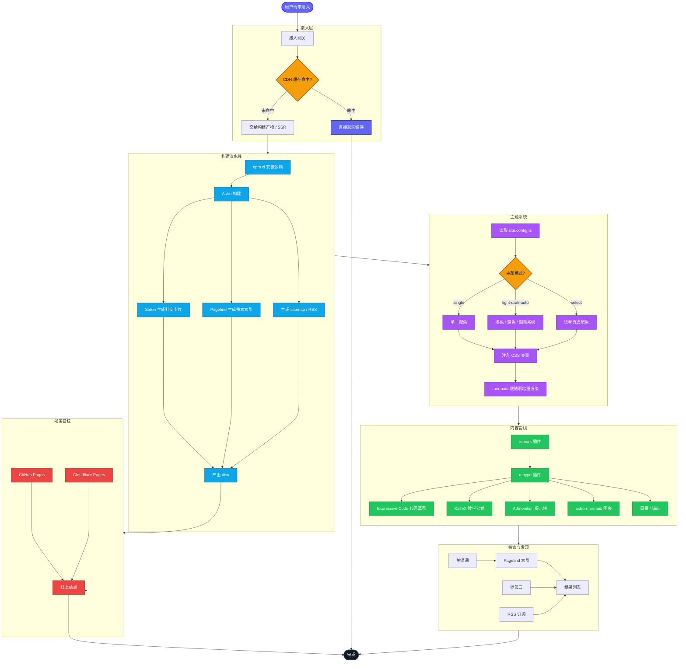

欢迎来到我的博客！这是第一篇文章，用来展示站点的排版效果，也顺便记录一下这个站点是怎么搭起来的。

## 这个博客用什么搭建的

站点基于 [Astro](https://astro.build/) 与 MultiTerm 主题，整体配置集中在 `src/site.config.ts` 一个文件里。写作只需要在 `src/content/posts/` 目录下新建 Markdown 文件。

## 一段示例代码

代码块会自动使用当前配色主题高亮：

```ts
export function greet(name: string): string {
  return `你好，${name}！`
}

console.log(greet('世界'))
```

## 支持的写法

- 标题、列表、引用、表格、图片等标准 Markdown
- KaTeX 数学公式：$E = mc^2$
- 提示块（admonition）
- 代码高亮、行号
- 自动生成目录（大屏显示在右侧）
- Mermaid 图表（自动跟随明暗主题切换，**点击图表可放大查看**）

下面这张图故意画得又长又复杂，用来测试多子图、跨子图连线、节点自定义样式，以及窄屏下的横向滚动：



:::note
这是一条 note 提示块。把 `note` 换成 `tip`、`important`、`caution`、`warning` 可以切换样式。
:::

## 下一步

编辑 `src/site.config.ts` 里的站点标题、作者、社交链接和配色，然后就可以开始写自己的文章了。
