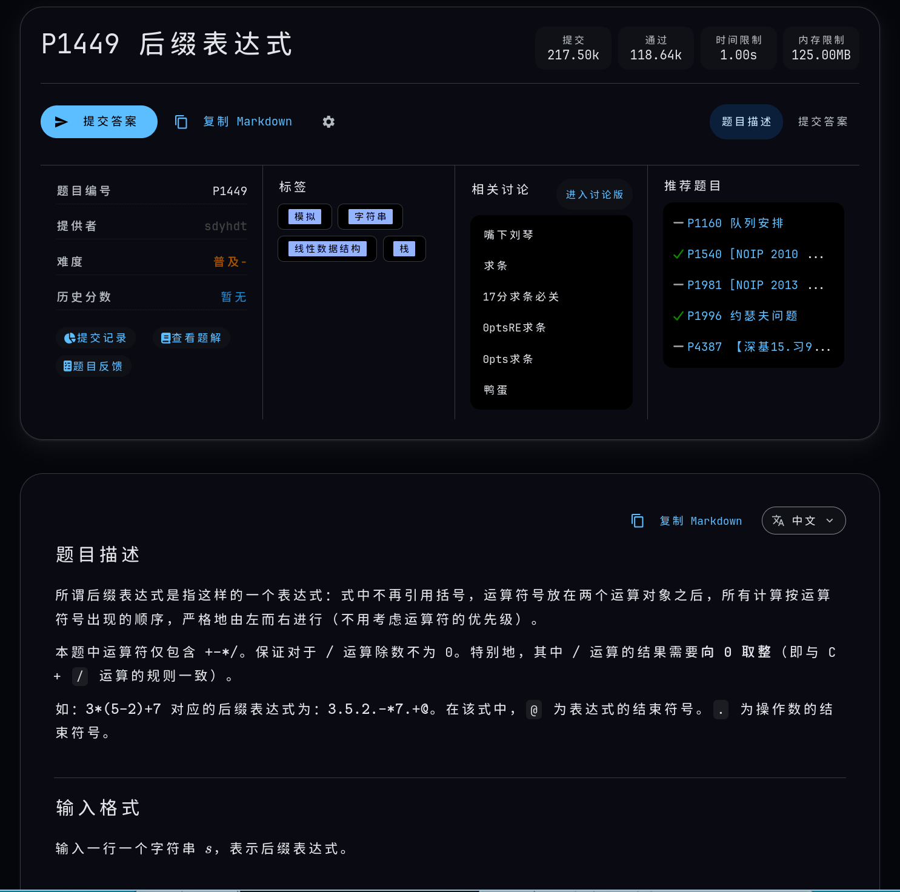
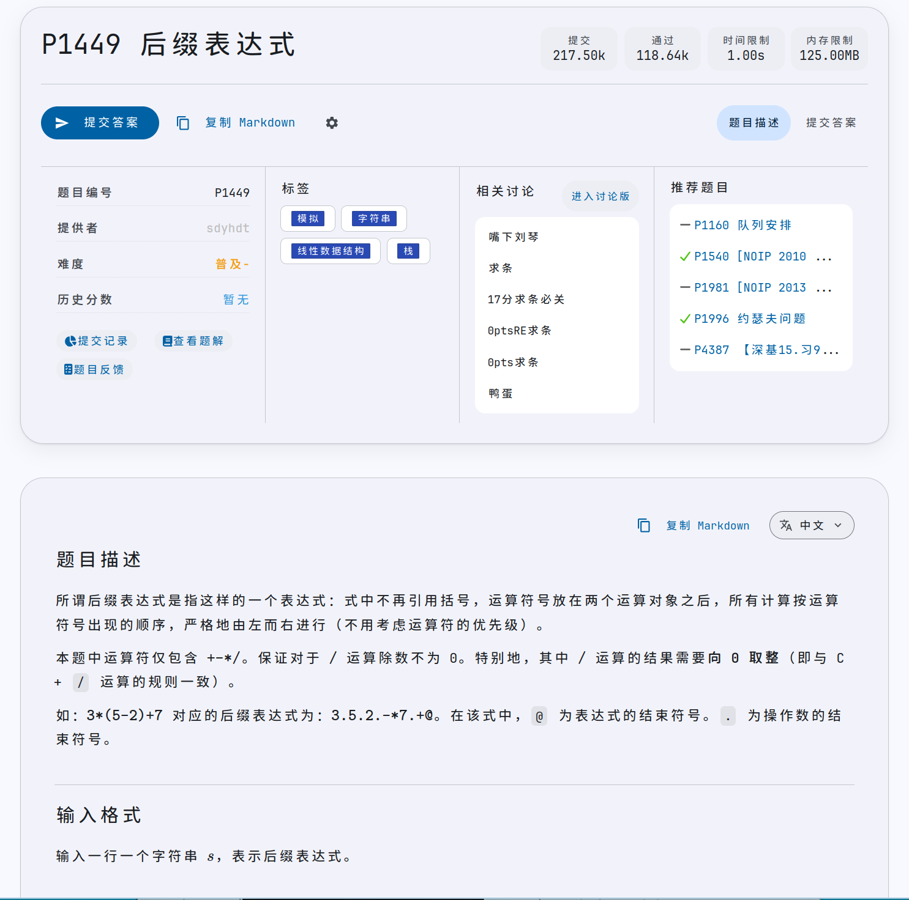
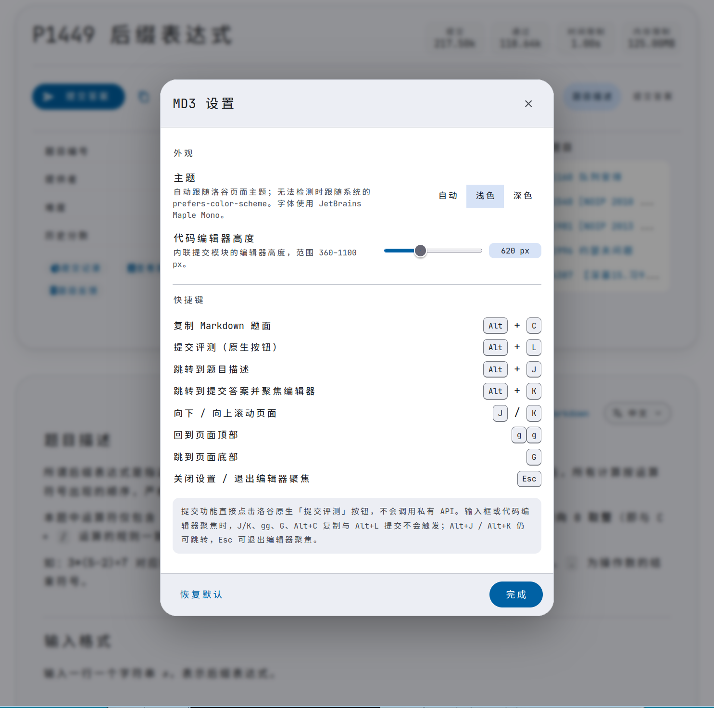

## AI泔水，凑合用
### 特点：
1. 明暗模式切换
2. 全键盘驱动
3. material design 3 设计
### 注意
1. 这是油猴脚本，需要提前在浏览器下载Tampermonkey插件。
2. 仅在Firefox上做过人工测试。遇到问题请自行vibecoding，不要找我。
3. 仅修改了problem页面，其他页面没有修改。
### 相关截图

 

 

### 下载链接
油猴脚本：[luogu-md3.user.js](/public/luogu-md3.user.js)
